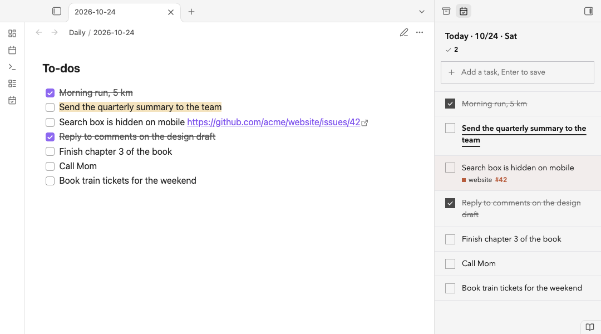
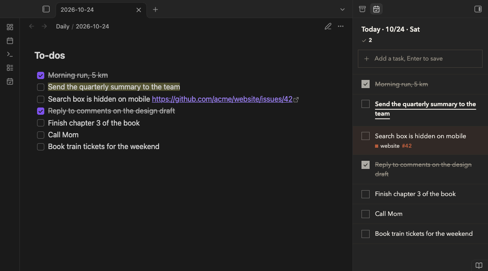
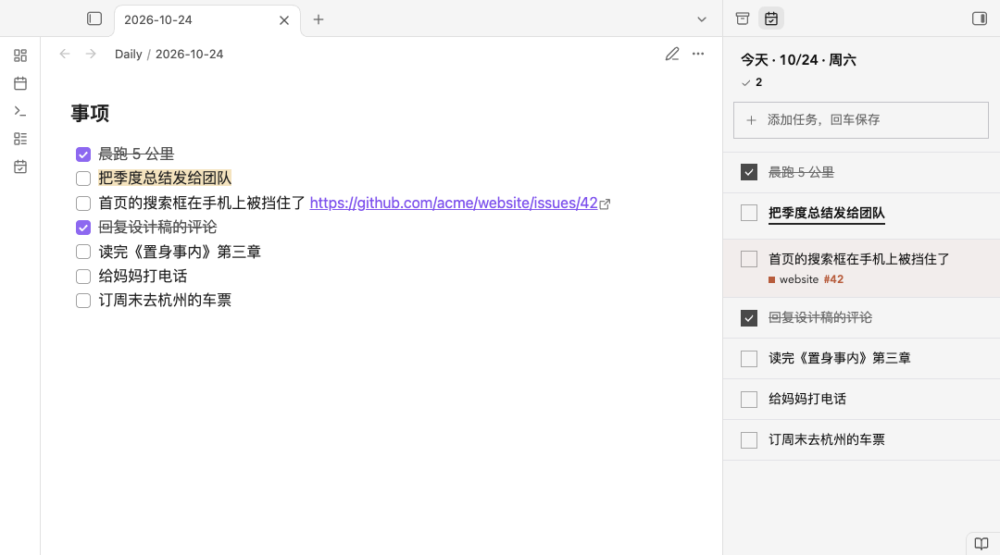

# 今日待办 · Today’s To-dos

Keeps today’s to-dos in today’s daily note.



- **Creates today’s note** when the day changes, or adds the to-do heading to the note your daily notes plugin or template just made. Nothing else in the note is touched.
- **Carries over what you didn’t finish.** Up to 20 unfinished to-dos from earlier days come along automatically once a day, with undo. If there are more, it only tells you.
- **A “Today” panel in the right sidebar.** Type and press Enter to add, click the box to check, right-click to star or delete (with undo). Hover the date to page through days.
- **Adds a to-do from anywhere** with the command “Add a to-do”, which you can bind to a hotkey.
- **Needs no other plugins.** It works without Daily Notes, Periodic Notes, Templater or Local REST API. On first run it reuses your daily notes settings if you have them.

The file stays plain Markdown:

```markdown
### To-dos
- [ ] Buy groceries
- [x] ==Reply to the email==
```

It is the same format the “今日待办 / Today’s To-dos” browser extension writes, so the two can share the same notes.



## Commands

| Command | What it does |
|---|---|
| Add a to-do | One line; Enter adds it to today |
| Open today | Opens today’s note with the cursor at the end of the to-dos |
| Bring unfinished to today | Brings every unfinished to-do from earlier days, with undo |
| Open in sidebar | Opens the “Today” panel |

## Settings

Where daily notes live, the file name (a moment.js format, as in the daily notes plugin), and which heading holds the to-dos. If your daily notes use a template, you can pick it too.

## With the browser extension (desktop only)

On desktop the plugin listens on `127.0.0.1:27125`, a local address that only your own computer can reach, for the companion browser extension. Click “Connect” in the extension’s settings, then “Allow” in Obsidian. No Local REST API, API key or certificate is needed.

- Only extensions you allowed can connect. Requests from web pages are refused.
- It can read and write notes and attachments in the vault, and nothing else: no hidden folders (the vault’s configuration folder with settings and plugins, `.git`, the trash) and no other file types such as scripts or web pages.
- Connected browsers are listed in the plugin’s settings and can be disconnected at any time.

On mobile this part is off; everything else works.

## Membership (optional)

Under Settings › Member, “Sign in” opens the Xiaoxiaodong member site in your browser and returns to Obsidian through `obsidian://yaoji-auth`. With a paid membership you can:

- **Send a to-do to GitHub.** Right-click it in the sidebar › Send to GitHub, then pick a repository (type to search). The to-do becomes an issue and the issue link is added to the to-do.
- **Tick off to-dos automatically.** When an issue you sent is closed as completed, the to-do in today’s or the last 14 days’ notes is checked. Issues closed as “not planned” or “duplicate” are left alone.

It is the same account and the same membership as the browser extension.

## Disclosures

- **Account:** member features need a Xiaoxiaodong account. Everything else works without one.
- **Payment:** member features (send to GitHub, automatic ticking) need a paid membership. Creating notes, carrying over, the sidebar, commands and the browser connection are free.
- **Network use:** without signing in, the plugin makes no internet requests. After you sign in, it talks only to `vip.xiaoxiaodong.ai`, and only for member features: to sign in and check your membership and GitHub connection, to load your repository list (once a day), to send the title and text of a to-do you chose to send to GitHub, and every 10 minutes (or when you come back to Obsidian) to ask whether the issues you sent were closed. The rest of your notes is never sent.
- **Local server:** on desktop, the local endpoint described above (`127.0.0.1:27125`) for the browser extension.
- No telemetry and no ads.

Privacy policy: https://vip.xiaoxiaodong.ai/plugins/yaoji/privacy

## License

Source available, all rights reserved: free to install and use for personal use, not to redistribute. See [LICENSE](LICENSE).

## Credits

- [lunar-javascript](https://github.com/6tail/lunar-javascript) (MIT, `licenses/lunar-javascript.LICENSE`) for the Chinese calendar line in the Chinese UI.

---

# 今日待办

今天的待办，放在今天的日记里。



- **自己建好今天的日记**：Obsidian 开着过了零点，或者第二天打开时，建好今天的日记，放好 `### 事项`。已经有日记（日记插件、模板刚建的）就只补这一节，别的不动。
- **把没做完的带过来**：以前没做完的，20 件以内每天第一次自动带到今天，能撤销；多了只说一句。
- **侧边栏里的今天**：右侧栏打开「今天」。顶上输入框，回车加一件；点方框勾掉，右键星标、删除（能撤销）；鼠标移到日期上可以翻前后一天。
- **随时加一件事**：命令面板里「今日待办：添加待办」，可以绑快捷键。
- **不依赖别的插件**：不用日记插件、Periodic Notes、Templater、Local REST API。第一次打开时如果你已经有日记设置，就直接沿用。

文件里就是普通的 Markdown，和浏览器扩展「今日待办」写的一模一样，两边可以一起用。

## 命令

| 命令 | 做什么 |
|---|---|
| 添加待办 | 一行输入，回车加到今天 |
| 打开今天 | 打开今天的日记，光标停在事项最后 |
| 把没做完的带到今天 | 以前没做完的全部带过来，能撤销 |
| 在侧边栏打开 | 右侧栏打开「今天」 |

## 设置

日记放在哪、文件名（moment 格式，和日记插件一样）、待办放在哪个标题下。用了模板时，可以选新日记用的模板。

## 和浏览器扩展一起用（只在电脑版）

电脑版 Obsidian 里，插件在 `127.0.0.1:27125` 开一个只有你这台电脑能连的接口，给浏览器扩展用。扩展设置里点「连接」，再在 Obsidian 里点「允许」就连上，不用装 Local REST API，也不用 API Key 和证书。

- 只认你允许过的扩展；网页发来的请求一律拒绝。
- 只能读写库里的笔记和附件：碰不到隐藏文件夹（库的设置文件夹里的设置和插件、`.git`、回收站），也不写脚本、网页这类文件。
- 设置里能看到连着的浏览器，随时断开。

手机上没有这一块，其他都能用。

## 会员功能（可选）

设置 › 会员 里点「登录」，会在浏览器里打开小小东会员站，登录后跳回 Obsidian（`obsidian://yaoji-auth`）。付费会员可以：

- **发到 GitHub**：侧边栏里右键一件事 › 发到 GitHub，选项目（打字就能找）。这件事变成那个项目的一个问题，问题地址接在这件事后面。
- **问题关了自动打勾**：今天和最近 14 天的日记里发过的事，GitHub 上关成「完成」就自动勾上；关成「不打算做」「重复」的不替你打勾。

和浏览器扩展是同一个账号、同一份会员。

## 说明

- **账号**：会员功能要小小东账号，其他都不用。
- **付费**：会员功能（发到 GitHub、自动打勾）要付费会员。建日记、带过来、侧边栏、命令、连浏览器扩展都免费。
- **联网**：不登录时插件不连外网。登录后只连 `vip.xiaoxiaodong.ai`，而且只为会员功能：登录、查会员和 GitHub 连接状态；取项目清单（一天一次）；把你选了「发到 GitHub」的那件事的标题和文字发过去；每 10 分钟（或回到 Obsidian 时）问一次发过的问题关没关。日记的其他内容不会发出去。
- **本机接口**：电脑版上给浏览器扩展用的 `127.0.0.1:27125`，见上面。
- 不统计使用情况，没有广告。

隐私说明：https://vip.xiaoxiaodong.ai/plugins/yaoji/privacy

## 许可

源码公开、保留所有权利：可以免费安装、个人使用，不能再分发。见 [LICENSE](LICENSE)。
